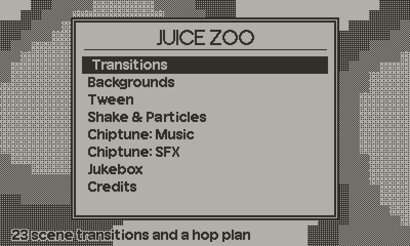
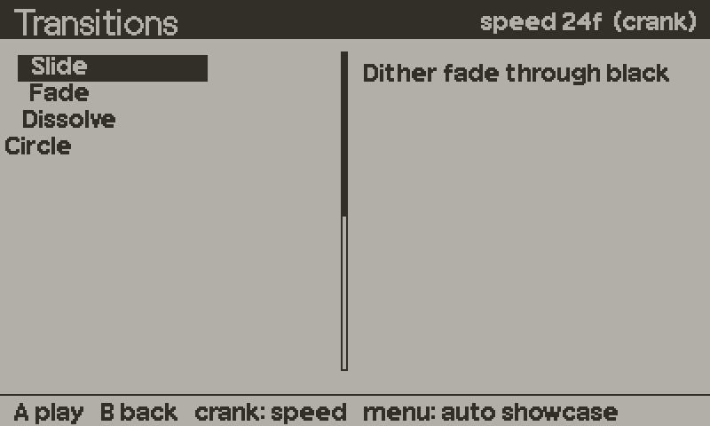
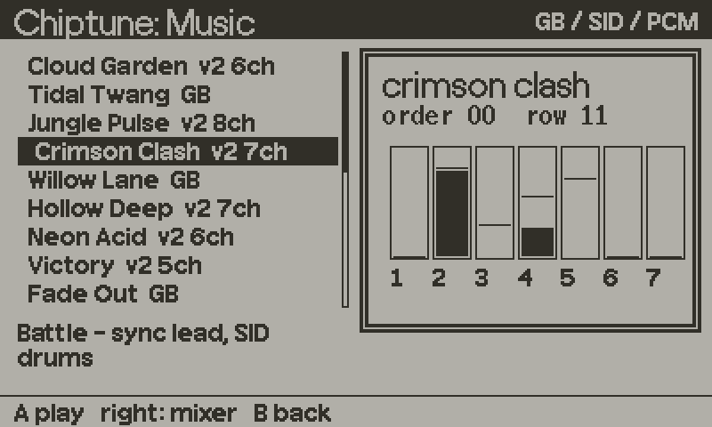
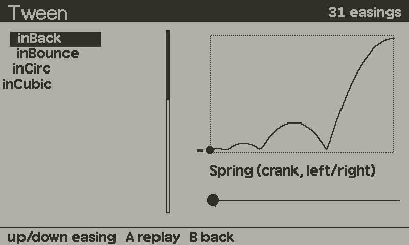
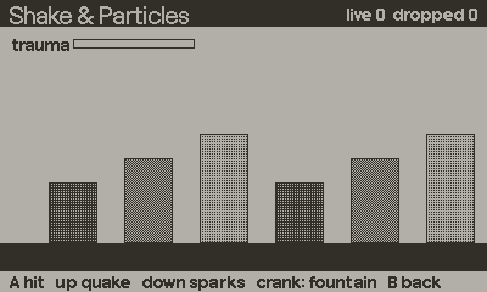
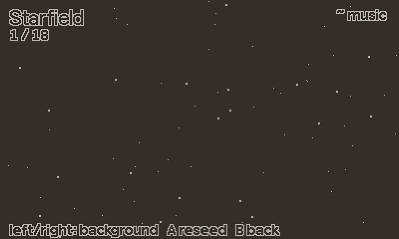
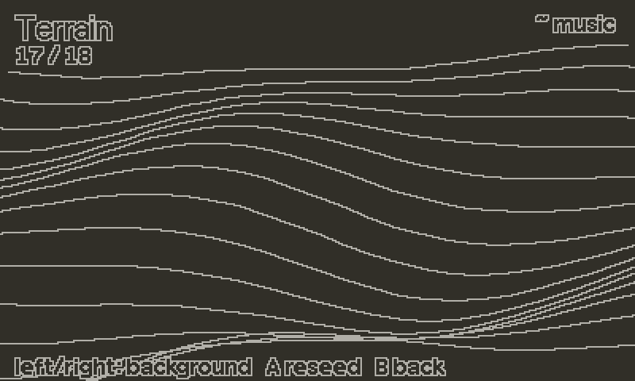
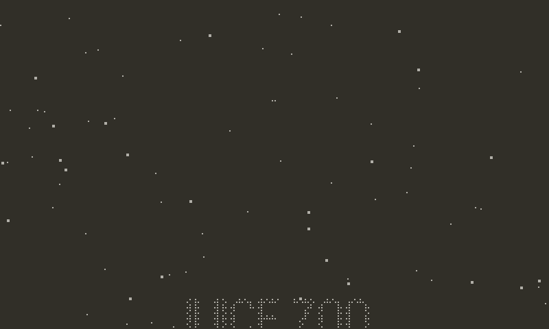
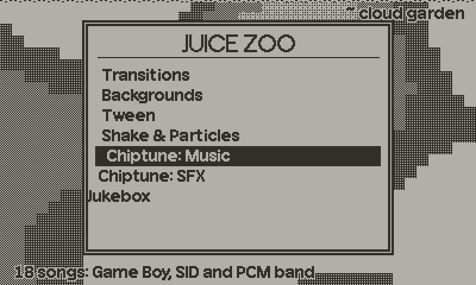

# playdate-juice

Drop-in game-feel modules for [Playdate](https://play.date/): scene
transitions, chiptune music and sound effects, streamed music, tweens, screen
shake, particles, music-reactive backgrounds, end credits and animated menus.



The modules are independent. Take one or take all of them: none imports
another. All but chiptune are single Lua files. Chiptune is a Lua file plus a
C extension (`chiptune/`).

| Module | Global | What it is |
|---|---|---|
| `transitions.lua` | `Transitions` | 23 direction-aware scene transitions + a scene-hop plan |
| `jukebox.lua` | `Jukebox` | streamed music: crossfades, ducking, pause handling |
| `chiptune.lua` + `chiptune/` | `Chiptune` | Game Boy, NES-style, 8-voice SID-style and sampled tracker music; 19 songs, 84 effects |
| `tween.lua` | `Tween` | 31 easings, sequences, parallel groups, springs |
| `shake.lua` | `Shake` | trauma-based screen shake with deterministic noise |
| `particles.lua` | `Particles` | pooled 1-bit particle system |
| `backgrounds.lua` | `Backgrounds` | 18 looping procedural backgrounds |
| `credits.lua` | `Credits` | end credits: rolls, held rows and cards that dissolve, fitted to the music |
| `ui.lua` | `UI` | animated menus: lists and grids with a springy highlight, key repeat, panels |

Everything except the C engine is host-testable: `lua test/run.lua` runs the
suite with no SDK and no device. See [CONVENTIONS.md](CONVENTIONS.md).
Reference pages and recipes for every module are in [docs/](docs/README.md).

## Install

Copy the `.lua` files you want into your `Source/`, or take the lot as a
submodule:

```bash
git submodule add https://github.com/jenissimo/playdate-juice Source/juice
```

```lua
import "juice/chiptune"
import "juice/transitions"
```

`pdc` compiles every `.lua` in your source tree, so a submodule brings its
`test/` and `demo/` along as a few dead `.pdz` files. Harmless, and there is
no build step to avoid.

## transitions

```lua
function changeScene()
    Transitions.start("Slide", "fwd", 24)   -- name, direction, frames
    currentScene = newScene
end

function playdate.update()
    if not Transitions.active then handleInput() end
    Transitions.draw(function() currentScene:draw() end)
end
```



Also a scene-hop plan (`Transitions.setPlan`, `Transitions.play("menu>rules")`).
→ [docs/transitions.md](docs/transitions.md)

## jukebox

```lua
Jukebox.load{ tracks  = { menu = "sound/menu", level = "sound/level" },
              volumes = { menu = 0.45, level = 0.55 } }

Jukebox.play("menu")                      -- no-op if already playing it
Jukebox.switch("menu", "level", 0.35, 0.30)
Jukebox.duck(0.22, 0.15); Jukebox.restore()
```

Wire `Jukebox.pause` / `Jukebox.resume` to `playdate.gameWillPause` /
`gameWillResume`.
→ [docs/jukebox.md](docs/jukebox.md)

## chiptune

```lua
Chiptune.load{ songs = { title = "juice/chiptune/music/cloud_garden.gbm" },
               sfx = "juice/chiptune/music/sfx.gbm" }
Chiptune.play("title")
Chiptune.sfx("coin")          -- the music ducks under it
Chiptune.mute({ "wav" })      -- the song keeps time
```

A tracker driver that runs in the audio callback, so tempo does not depend on
your frame rate. Four song formats (Game Boy, up to 8 SID-style voices, sampled,
sample banks), 19 demo songs and an 84-effect SFX library, including a whoosh
each way for every transition. It needs its C half built into the game. Without
it, `tools/chiptune.py render-all` turns the same music into ADPCM files for
Jukebox.



→ [docs/chiptune.md](docs/chiptune.md), and [chiptune/README.md](chiptune/README.md) for the engine, the file format and writing songs.

## tween

```lua
Tween.to(sprite, 30, { x = 200, y = 120 }, "outBack"):onComplete(done)
Tween.sequence(Tween.field(o, 20, "y", 100), Tween.delay(10), Tween.call(fn))
local spring = Tween.newSpring(0, 8)   -- value, smooth time in frames

function playdate.update() Tween.update() end
```



Steps by frame count, runs on the host, and allocates nothing per frame.
→ [docs/tween.md](docs/tween.md)

## shake

```lua
Shake.load()
local sh = Shake.new("hit")
sh:add(0.6)

function playdate.update()
    sh:update()
    Shake.apply(sh); drawWorld(); Shake.pop()
end
```

→ [docs/shake.md](docs/shake.md)

## particles

```lua
Particles.load()
local ps = Particles.new(200)
ps:emit(x, y, "spark", 12)

function playdate.update()
    ps:update(); ps:draw()
end
```

→ [docs/particles.md](docs/particles.md)

## backgrounds

```lua
function playdate.update()
    Backgrounds.update(1); Backgrounds.draw(1)
end
```

<p>


</p>

Feed them the music and seven of them play along:

```lua
Backgrounds.setLevels(Chiptune.levels())
```



→ [docs/backgrounds.md](docs/backgrounds.md)

## credits

```lua
local roll = Credits.new({
    { title = "MY GAME", sub = "a puzzle about cats" },
    { heading = "Code" },
    { role = "Programming", name = "Zhenya" },
    { role = "Music", names = { "gameboy-lab", "Zhenya" } },
    { card = "THE END", hold = 60 },
}, { fit = 30 * 95, invert = true, background = function() Backgrounds.draw(5) end })

function playdate.update()
    roll:update()   -- the crank scrubs, A fast-forwards, B skips to the last card
    roll:draw()
end
```



`fit` solves the scroll speed so the last card lands on the song's last bar.
→ [docs/credits.md](docs/credits.md)

## ui

```lua
local rep  = UI.repeater()
local menu = UI.list{ items = { "Play", "Options", "Quit" },
                      x = 120, y = 90, w = 160, rowH = 18, visible = 3 }
menu:enter()                         -- rows slide in one after another

function playdate.update()
    rep:poll()
    menu:navigate(rep)               -- up/down, wraps, repeats when held
    if playdate.buttonJustPressed(playdate.kButtonA) then menu:confirm() end
    menu:draw()
end
```



The highlight fills in and springs between rows, the selected row nudges
over, a wrap bumps the list. Every effect can be tuned or turned off.
→ [docs/ui.md](docs/ui.md)

## Demo

The Zoo: one exhibit per module, with the chiptune songs as its soundtrack.

```bash
python tools/build_demo.py            # Lua + the chiptune extension (simulator, and device with arm-none-eabi-gcc)
python tools/build_demo.py --lua-only # no C compiler: runs without chiptune
```

Then open `demo/Juice.pdx`. The build needs the Playdate SDK, CMake and a host
C compiler for the extension; `ARM_GCC_BIN` can point at a toolchain that is
not on PATH.

The GIFs in this README are filmed in the Zoo itself: `demo/record.lua.in`
plays it with scripted presses and crank turns, and every frame of a clip is
written out and encoded in the Playdate's two colours.

```bash
python tools/record_gifs.py           # build, film in the simulator, encode into build/gifs/ (needs Pillow)
python tools/record_gifs.py --encode-only tween   # re-encode frames already filmed
```

They live on the `media` branch rather than here, so a game that submodules
this repo does not get a dozen megabytes of GIFs copied into its `.pdx`.

## Tests

```bash
lua test/run.lua
python tools/chiptune.py test   # ROM traces, formats 2/3/4, banks, encoder and shipped songs
```

## Made with playdate-juice

- [Crankball](https://happydoggames.itch.io/crankball)
- [Glidr](https://play.date/games/glidr/)

Shipping a game that uses these modules?
[Open an issue](https://github.com/jenissimo/playdate-juice/issues/new?title=Showcase%3A%20) with a link and it goes on this list.

## License

MIT. The chiptune driver, its format, drum recipes and wave synth come from
gameboy-lab.
