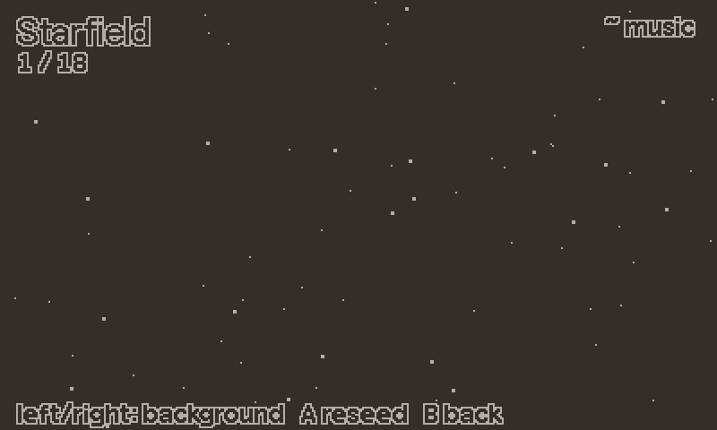
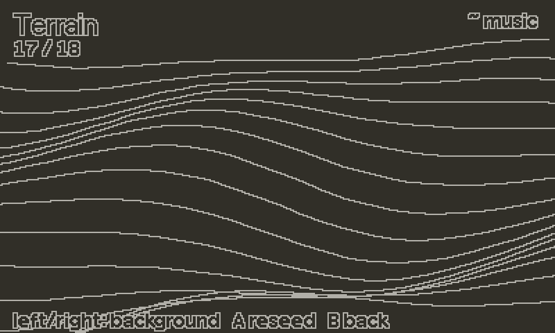

# backgrounds





18 full-screen, 1-bit procedural backgrounds that loop forever. Each is a small simulation plus a renderer, picked by index. Seven of them can also play to the music (see [Music-reactive](#music-reactive)). Only the backgrounds you actually draw are built, and every cyclic value wraps on its exact period, so a long session does not drift or stutter.

## Setup

```lua
import "juice/backgrounds"
```

No setup is needed. `Backgrounds.draw` calls `Backgrounds.load()` for you. Call it yourself only to set a seed or to build backgrounds ahead of time.

## Minimal example

```lua
function playdate.update()
    Backgrounds.update(1)    -- advance background 1 (Starfield)
    Backgrounds.draw(1)      -- render it
    drawGame()               -- on top
end
```

`draw` clears and fills the whole screen, so call it first.

## The backgrounds

| # | Name | # | Name | # | Name |
|---|---|---|---|---|---|
| 1 | Starfield | 7 | Lava Lamp | 13 | Moire |
| 2 | Waves | 8 | Dither Hills | 14 | Lightning |
| 3 | Radar | 9 | Bubbles Rise | 15 | Confetti |
| 4 | Rain | 10 | Plasma | 16 | Life |
| 5 | Squares | 11 | Matrix Rain | 17 | Terrain |
| 6 | Spirograph | 12 | Fire | 18 | Equalizer |

## Recipes

### Pick by name

Names are stable, indexes are easy to mix up.

```lua
local BG = Backgrounds.indexOf("Plasma")

function playdate.update()
    Backgrounds.update(BG)
    Backgrounds.draw(BG)
end
```

### Update only what you show

`update()` with no argument steps the background that was last drawn. This is the usual form.

```lua
Backgrounds.update()
Backgrounds.draw(currentBg)
```

On the very first frame nothing has been drawn yet, so `update()` does nothing. Pass the index once, or call `draw` first.

### Avoid a hitch when a transition lands

A background is built the first time it is used. If that would be visible, build it ahead of time.

```lua
Backgrounds.load{ preload = { 1, 10, 12 } }
```

### Cycle with the buttons

```lua
local bg = 1
function playdate.update()
    if playdate.buttonJustPressed(playdate.kButtonRight) then
        bg = bg % Backgrounds.count + 1
    end
    Backgrounds.update(bg)
    Backgrounds.draw(bg)
    gfx.drawText(Backgrounds.getName(bg), 4, 4)
end
```

### Behind the credits

See [credits.md](credits.md). `background` is a function the roll calls for its backdrop.

```lua
local roll = Credits.new(script, {
    invert = true,
    background = function() Backgrounds.draw(1) end,
})

function playdate.update()
    Backgrounds.update(1)
    roll:update()
    roll:draw()
end
```

### Music-reactive

Feed the channel levels once per frame and the reactive backgrounds follow them. `backgrounds.lua` imports nothing: it only receives numbers, 0 to 15 per channel, which is exactly what `Chiptune.levels()` returns.

```lua
function playdate.update()
    Chiptune.update()
    Backgrounds.setLevels(Chiptune.levels())   -- every frame, before update
    Backgrounds.update(bg)
    Backgrounds.draw(bg)
end
```

`setLevels` takes the levels as separate values or as one array (`Backgrounds.setLevels({ 15, 4, 0, 9 })`), up to 8 channels. Values are clamped to 0..15. With no levels, or all zeros, every background looks exactly as it did before; when the music stops, the motion decays back to that state by itself.

The levels are smoothed (fast attack, slower decay), so shapes pulse instead of jittering. A sudden rise in any channel also counts as a hit: a short pulse that decays over a few frames, with a small gap before the next one, so a drum roll does not blur into one long flash.

| Background | What the music does |
|---|---|
| Terrain | Ridge height per column, spread across the channels left to right like a spectrum. Scroll speed follows the loudest channel, hits lift the whole mesh. |
| Equalizer | 16 segmented bars interpolated across the channels, with peak-hold markers. Idles as stubs and a scanning dot. |
| Radar | Sweep and rings speed up with the level, rings surge and the centre dot swells on a hit. |
| Starfield | Flight speed follows the level, a hit lurches forward and flares the stars. |
| Dither Hills | Hill layer *n* swells and drifts faster with channel *n*. |
| Plasma | Drift speed follows the level. |
| Lightning | A hit strikes at once (not during the flash of the previous strike). |

A menu can ask `Backgrounds.isReactive(index)` to tell which ones respond. `Backgrounds.resetLevels()` drops to silence immediately instead of decaying, for example on a scene change.

### Reproducible look, or restart one

```lua
Backgrounds.load{ seed = 123 }    -- all backgrounds start from this seed
Backgrounds.reset(15)             -- rebuild Confetti from its initial state
Backgrounds.reset(15, 99)         -- or with a seed of your own
```

## API reference

| Function | Description |
|---|---|
| `Backgrounds.update(index)` | Advances one frame. Without `index`, uses the background last drawn (does nothing if none). |
| `Backgrounds.draw(index)` | Renders it, clearing the screen. Returns true if drawn, false for an unknown index or no SDK. Leaves the draw colour black. |
| `Backgrounds.setLevels(...)` | This frame's channel levels, 0..15 each, as values or one array (max 8). Smooths them and detects hits. Call once per frame before `update`. |
| `Backgrounds.resetLevels()` | Silence at once, with no decay tail. |
| `Backgrounds.isReactive(index)` | True if that background responds to `setLevels`. |
| `Backgrounds.load(opts)` | Optional. `opts.seed` sets the base seed and discards built backgrounds. `opts.preload` is a list of indexes to build now. Returns true if the SDK is present. |
| `Backgrounds.reset(index, seed)` | Rebuilds one background. The default seed is derived from the base seed and the index. |
| `Backgrounds.state(index)` | The background's state table, built if needed. For tests. |
| `Backgrounds.getName(index)` | Name, or nil. |
| `Backgrounds.indexOf(name)` | Index, or nil. |
| `Backgrounds.margin(index)` | How far outside the screen the background may draw items, in pixels. |
| `Backgrounds.ditherPixels(level)` | Lit pixels in the 8x8 tile for a dither level. |
| `Backgrounds.safeDither(level)` | Clamps a dither level to 1/64..1. |

| Field | Description |
|---|---|
| `Backgrounds.names` | List of the names, in index order. |
| `Backgrounds.count` | 18. |
| `Backgrounds.audio` | Read-only readouts of the smoothed input: `n` (channels fed), `env[i]` (0..1 each), `energy` (loudest channel), `beat` (1 on a hit, then decaying), `onset` (true on the frame of a hit). |
| `Backgrounds.current` | Index last drawn. |
| `Backgrounds.SCREEN_W`, `Backgrounds.SCREEN_H` | 400, 240. |
| `Backgrounds.DITHER_FLOOR`, `Backgrounds.DITHER_LEVELS` | Dither limits and the levels in use. |

## Gotchas

- `update` and `draw` are separate. A background that you draw but never update stays frozen.
- `draw` fills the whole screen. Draw backgrounds before everything else.
- Several backgrounds change the draw colour. `draw` resets it to black before returning.
- `Backgrounds.update()` without an index only steps the last drawn one. Switching background does not carry the old animation along.
- `Backgrounds.load{ seed = n }` throws away backgrounds that were already built.
- Without the SDK, `update` still simulates, and `draw` returns false.
