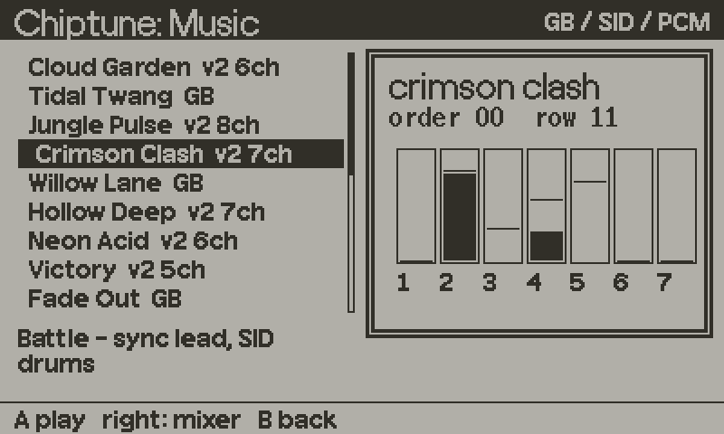

# chiptune



Tracker music and sound effects. The engine is a C extension that renders a Game Boy style driver (and an 8-voice SID-style synth and a sampler) inside the audio callback, so tempo never depends on your frame rate. `chiptune.lua` is the Lua API over it: load songs, play, fire effects by name, mute channels, and react to sync markers in the song.

This page covers the Lua API. The C engine, the song file format, the SFX list and how to write songs are in [chiptune/README.md](../chiptune/README.md).

## Setup

The C half has to be compiled into your game. The short version for a CMake project, with the repo at `Source/juice`:

```cmake
include(${CMAKE_CURRENT_SOURCE_DIR}/Source/juice/chiptune/chiptune.cmake)
if (TOOLCHAIN STREQUAL "armgcc")
	add_executable(${PLAYDATE_GAME_DEVICE} ${CHIPTUNE_SOURCES} ${CHIPTUNE_MAIN})
else()
	add_library(${PLAYDATE_GAME_NAME} SHARED ${CHIPTUNE_SOURCES} ${CHIPTUNE_MAIN})
endif()
```

Details, including games with their own C, are in [chiptune/README.md](../chiptune/README.md). Then, in Lua:

```lua
import "juice/chiptune"

Chiptune.load{
    songs = { title = "juice/chiptune/music/cloud_garden.gbm" },
    sfx   = "juice/chiptune/music/sfx.gbm",
}
```

Without the C extension, `Chiptune.load` returns `false, reason`, `Chiptune.available` stays false and every other call does nothing. Your game still runs. You can render the same songs to ADPCM files and play them with [Jukebox](jukebox.md), see the "Without the C extension" section of the engine README.

## Minimal example

```lua
import "juice/chiptune"

Chiptune.load{
    songs = { title = "juice/chiptune/music/cloud_garden.gbm" },
    sfx   = "juice/chiptune/music/sfx.gbm",
}
Chiptune.play("title")

function onCoin() Chiptune.sfx("coin") end

function playdate.update()
    Chiptune.update()   -- only needed for onSync and onEnd callbacks
end

function playdate.gameWillPause()  Chiptune.pause()  end
function playdate.gameWillResume() Chiptune.resume() end
```

## Recipes

### Layered music

Muting a channel does not stop the song, so unmuting brings the part back in on the beat. Channels are `"pu1"`, `"pu2"`, `"wav"`, `"noi"`, or numbers 1 to 8 for songs with more voices.

```lua
Chiptune.play("battle")
Chiptune.mute({ "wav", "noi" })     -- calm: melody only

function onEnemySpotted()
    Chiptune.mute({})               -- everything back in
end
```

### React to the music

Put an `Exx` command in the song, and `onSync` calls you when the song passes it. Call `Chiptune.update()` every frame.

```lua
Chiptune.onSync(function(value)
    if value == 1 then boss:enter() end
end)

Chiptune.onEnd(function(name)       -- songs without a loop
    if name == "victory" then showResults() end
end)
```

### Hold the music for a wait

`hold(order)` repeats one order until you release it. Use it for "loop here until the boss is ready".

```lua
Chiptune.hold(3)      -- loop order 3
-- when ready
Chiptune.hold(nil)    -- continue
```

### Pulse with the music

`levels()` returns the current level (0 to 15) of each music channel.

```lua
local pu1, pu2, wav, noi = Chiptune.levels()
drawMeter(noi)
```

### Songs with a sample bank

Formats 3 and 4 embed or share PCM samples. A song that uses a bank is given as a table.

```lua
Chiptune.load{
    banks = { band = "juice/chiptune/music/rock.gbank" },
    songs = { rock = { path = "juice/chiptune/music/steel_circuit.gbm", bank = "band" } },
    sfx   = "juice/chiptune/music/sfx.gbm",
}
```

### Sounds for transitions

The shipped SFX bank has a whoosh per [transition](transitions.md) and direction. Hook it up once:

```lua
TransitionSounds = {
    play = function(name, dir)
        return Chiptune.sfx("tr_" .. name:lower():gsub(" ", "_") .. "_" .. dir)
    end,
}
```

## API reference

### Loading

| Function | Description |
|---|---|
| `Chiptune.load(spec)` | Loads everything in `spec`. Returns `true`, or `false` and a reason. See below. |
| `Chiptune.available` | True once `load` found the C extension. False before `load` is called. |

`spec` fields:

| Field | Description |
|---|---|
| `songs` | `{ name = path }` or `{ name = { path = p, bank = alias } }`. |
| `banks` | `{ alias = path }` of `.gbank` sample banks. Loaded once per path. |
| `sfx` | Path of an SFX bank. Effect names are read from the file. |
| `duck` | `{ amount = 6, speed = 2 }`. Music volume drops `amount` envelope steps (0 to 15) while an effect plays, one step every `speed` frames. `amount = 0` turns ducking off. Default `{ amount = 6, speed = 2 }`. |
| `volume` | 0 to 1, music volume. Not set by default. |

### Playback

| Function | Description |
|---|---|
| `Chiptune.play(name, opts)` | Plays song `name`. Returns true on success, false for an unknown name or if not loaded. Does nothing and returns true if that song is already playing. `opts = { order = 0, row = 0, restart = false }`. `restart = true` plays from the start even if it is already playing. |
| `Chiptune.stop()` | Stops the music. |
| `Chiptune.pause()` / `Chiptune.resume()` | For `playdate.gameWillPause` and `gameWillResume`. |
| `Chiptune.setVolume(l, r)` | 0 to 1. `r` defaults to `l`. |
| `Chiptune.mute(channels)` | Silences the listed channels: names, numbers 1 to 8, or a raw bit mask. An empty table unmutes. The song keeps time. An unknown channel raises an error. |
| `Chiptune.hold(order)` | Repeats `order` until called with nil. |
| `Chiptune.duck(amount, speed)` | Changes the ducking set in `load`. `speed` defaults to 1. |

### Effects

| Function | Description |
|---|---|
| `Chiptune.sfx(id)` | Fires an effect by name or by 0-based index. Returns the driver's result, or false for an unknown effect. An effect with lower priority than the ones already sounding is dropped. |
| `Chiptune.stopSfx()` | Stops all effects. |
| `Chiptune.sfxNames()` | List of the loaded effect names, in bank order. |
| `Chiptune.sfxIndex(id)` | Index for a name (or the number itself), or nil. |

### Callbacks and state

| Function | Description |
|---|---|
| `Chiptune.onSync(fn)` | `fn(value)` when the song passes an `Exx` command. Needs `Chiptune.update()` each frame. |
| `Chiptune.onEnd(fn)` | `fn(name)` when a song without a loop ends. Needs `Chiptune.update()`. |
| `Chiptune.update()` | Call once per frame to run the callbacks. Playback does not depend on it. |
| `Chiptune.position()` | `order, row`: the next row to play. `0, 0` when not loaded. |
| `Chiptune.levels()` | A level 0 to 15 per music channel (4 for Game Boy songs, up to 8 otherwise). |
| `Chiptune.current()` | Name of the playing song, or nil. |
| `Chiptune.isPlaying()` | True while a song plays. |
| `Chiptune.mask(channels)` | Converts a channel list to the mute mask. |
| `Chiptune.parseNames(bytes)` | Reads the SFX names from an encoded bank. Used by `load`. |

## Gotchas

- `Chiptune.available` is false until you call `Chiptune.load`.
- `onSync` and `onEnd` only fire if you call `Chiptune.update()` every frame.
- Pause hooks are required, or the music plays over the system menu.
- Effect names depend on the bank. The shipped bank has 84, listed in [chiptune/README.md](../chiptune/README.md#sfx).
- `pdc` copies everything in a submodule into the `.pdx`, including the C sources and about 20 songs. Copy only the `.gbm` and `.gbank` files you use into your own `Source/`.
- If anything loaded is format 2 or later (the shipped SFX bank is), Game Boy songs play on the other synth: same pitches, slightly different pulse edges. Load a format 1 SFX bank, or none, for exact DMG output.
- `Chiptune.load` stops at the first song or bank that fails and returns `false` with the reason. Print it during development.
