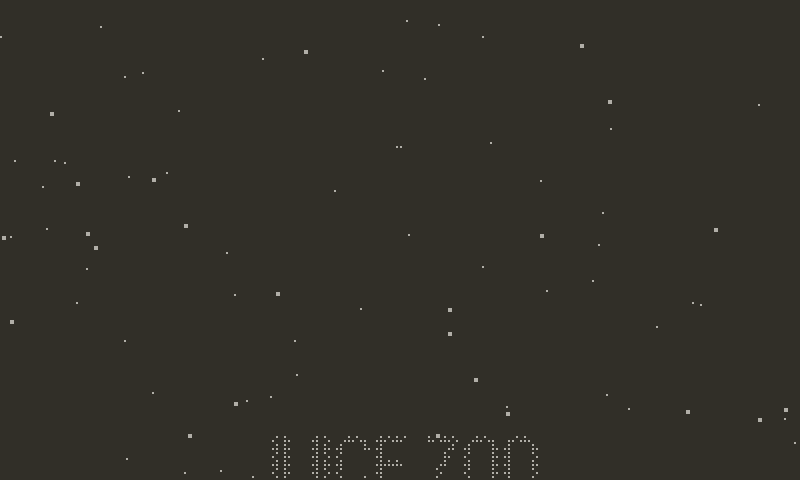

# credits



End credits and title cards. You write a script, a plain Lua table of titles, headings, role and name pairs, name grids, paragraphs, logos and cards. It becomes a timed presentation: a roll that scrolls up and can stop on chosen rows, then centred cards that dissolve in and out. Headings type themselves in, names slide in, and rows dither out at the screen edges over any backdrop.

The picture at any moment is a function of one frame clock. That is why the crank can scrub backwards, A can fast-forward, B can skip to the last card, and why you can fit the whole thing to a song length.

## Setup

```lua
import "juice/credits"
```

Nothing to load. `Credits.new(script, opts)` builds the layout, fonts and images, so call it when the credits scene starts, not every frame. It raises an error for a bad script.

## Minimal example

```lua
local roll = Credits.new({
    { title = "MY GAME", sub = "a short story" },
    { heading = "Code" },
    { role = "Programming", name = "Ann" },
    { heading = "Music" },
    { role = "Composer", names = { "Bo", "Cy" } },
    { card = "THE END" },
})

function playdate.update()
    roll:update()    -- crank scrubs, A fast-forwards, B skips to the last card
    roll:draw()
end
```

The system font has no Cyrillic. Pass `fonts` that do (see below).

## Script entries

A bare string is a paragraph (`{ text = s }`). Each entry has exactly one of these keys:

| Entry | Notes |
|---|---|
| `{ title = "NAME", sub = "line" }` | Pixel-doubled unless you pass `fonts.title`. `scale` overrides the factor. |
| `{ heading = "Music" }` | Centred, with side rules. `rules = false` hides them. |
| `{ role = "Composer", name = "Ann" }` | Or `names = { "Ann", "Bo" }`. Layout comes from the `style` option. |
| `{ name = "Ann" }` | One centred name. |
| `{ names = { ... }, columns = 3 }` | A grid. `columns` defaults to as many as fit, up to 4. |
| `{ text = "A paragraph..." }` | Word-wrapped. `width` limits the line width. |
| `{ image = "images/logo", ink = true }` | A path or an image. `ink = true` tints it to the text colour. A missing file leaves an empty gap of `w` by `h` (default 0). |
| `{ rule = true }` | A divider. `width` sets its length (default 120). |
| `{ space = 40 }` | Extra vertical room. |
| `{ card = "THE END" }` or `{ card = { entries } }` | A centred card. A string becomes a title. A card cannot hold a card. |

Any entry also accepts:

| Key | Description |
|---|---|
| `gap` | Pixels above it. Defaults depend on the kind (`Credits.GAPS`). |
| `align` | `"left"`, `"center"` or `"right"`. |
| `reveal` | `"slide"`, `"type"`, `"fade"` or `"none"`. Defaults in `Credits.REVEALS`: titles and roles slide, headings type, grids, text and images do not animate. Cards default to `"fade"`. |
| `hold` | Frames. In a roll, it stops scrolling with the entry centred. In a card, how long it stays fully shown. `hold = true` stops there for good, and it must be the last entry. The last card stays by default. Give it a number to make it leave. |
| `on` | `fn(roll, entry, x, y)`, called when the entry reaches the centre line (a card: when it starts). |

Cards also accept `fadeIn`, `fadeOut` and `stagger`.

## Options

```lua
Credits.new(script, {
    speed = 1,            -- px per frame
    fit = 30 * 95,        -- or: total length in frames
    style = "split",      -- "split", "leader" or "stack"
    ...
})
```

| Option | Default | Description |
|---|---|---|
| `speed` | 1 | Scroll speed in pixels per frame. |
| `fit` | nil | Total length in frames. Solves `speed` so the last row lands on that frame. Overrides `speed`. |
| `style` | `"split"` | Role and name layout. `"split"`: role, then name, either side of the centre. `"leader"`: role, dotted leader, name. `"stack"`: role above name. A row that does not fit in `"split"` stacks. An entry can set its own `style`. |
| `fonts` | system fonts | `{ title =, sub =, heading =, role =, name =, text = }`, each a font or a path. |
| `font` | nil | One font for every style that `fonts` does not set. |
| `titleScale` | 2 | Pixel doubling for titles. 1 if `fonts.title` is set. |
| `invert` | false | White text on black. |
| `background` | clears to paper | `fn(roll)` that paints the backdrop. `false` draws over whatever is on screen. |
| `margin`, `gutter` | 24, 16 | Side margin, and the space between role and name in `"split"`. |
| `split` | 200 | X of the split line. |
| `rules` | true | Heading side rules. |
| `fade` | 24 | Height in pixels of the dithered edge band. 0 is a hard cut. |
| `reveal` | nil | Default reveal for entries that do not set one. |
| `revealSpan` | 40 | Pixels over which a row reveals as it enters. |
| `card` | see below | `{ fadeIn = 15, hold = 60, fadeOut = 12, stagger = 4 }`. |
| `controls` | true | Crank, A and B. |
| `fast` | 4 | Speed multiplier while A is held. |
| `crank` | 0.5 | Frames per degree of crank. |
| `onType` | nil | `fn(roll)` on frames where a typing row shows more letters. Use it for a typewriter tick. |
| `metrics` | nil | Host tests: `width(style, s)`, `height(style)`, `image(entry)`. |

## Recipes

### Fit the credits to a song

Count the song length in frames: seconds times the frame rate. For a 95 second track at 30 fps:

```lua
local roll = Credits.new(script, { fit = 30 * 95 })
Chiptune.play("ending")     -- or Jukebox.play("ending")
```

Holds and cards take a fixed number of frames, and the scroll speed is solved from the rest. If the holds and cards alone are longer than `fit`, `Credits.new` raises an error.

### Cues: a jingle, a shake, a burst

```lua
{ image = "images/logo", ink = true, hold = 45,
  on = function() Chiptune.sfx("magic"); shake:add(0.6) end },
{ card = "THE END", hold = 60,
  on = function(r, entry, x, y) particles:emit(x, y, "burst") end },
```

Cues fire when the clock moves forward over them. Scrubbing back and forth re-arms them. `roll:seek` does not fire anything.

### Over a background, in white on black

```lua
local roll = Credits.new(script, {
    invert = true,
    background = function() Backgrounds.draw(1) end,
})

function playdate.update()
    Backgrounds.update(1)
    roll:update()
    roll:draw()
end
```

### Stop on the logo and wait

```lua
{ image = "images/logo", hold = true }
```

`hold = true` ends the credits on that entry. Nothing may follow it.

### Leave when finished

```lua
roll:onEnd(function() goTo("menu") end)
```

`done` becomes true when the clock reaches the end. If the script ends with a card, the end is the moment that card has fully appeared, and the card then stays on screen. To make it hold and fade out first, give it a number: `{ card = "THE END", hold = 60 }`.

### Cyrillic or a custom font

```lua
local roll = Credits.new(script, {
    fonts = { title = "fonts/Big", name = "fonts/Body", heading = "fonts/Body" },
    font = "fonts/Body",
})
```

Paths are loaded with `playdate.graphics.font.new`. A missing font raises an error.

### Your own controls

```lua
local roll = Credits.new(script, { controls = false })
roll.rate = 0          -- paused
roll:advance(2)        -- move 2 frames, firing cues
roll:seek(0)           -- jump, silently
roll:skip()            -- to the last card
roll:restart()
```

## API reference

### Module

| Function | Description |
|---|---|
| `Credits.new(script, opts)` | Builds a roll. |
| `Credits.layout(script, opts, metrics)` | The pure planner behind `new`, for tests. Returns the plan. |
| `Credits.load()` | Marks the SDK available. Called by `new`. |
| `Credits.wrap(text, width, measure)` | Word wrap. Returns a list of lines. |
| `Credits.kindOf(entry)` | The entry's kind. |
| `Credits.ulen(s)`, `Credits.uprefix(s, n)` | UTF-8 length and prefix. |
| `Credits.GAPS`, `Credits.REVEALS`, `Credits.HOST_METRICS` | Defaults. |

### Roll methods

| Method | Description |
|---|---|
| `roll:update()` | One frame. Reads crank, A and B if `controls`, then advances by `rate`. |
| `roll:draw()` | Draws the current frame. Does nothing without the SDK. |
| `roll:advance(n)` | Moves the clock `n` frames (default 1, negative rewinds) and fires cues passed on the way forward. |
| `roll:seek(frame)` | Jumps to a frame without firing cues. |
| `roll:skip()` | Jumps to the last card. The cue on that card still fires. |
| `roll:restart()` | Back to frame 0. Cues re-arm. |
| `roll:onEnd(fn)` | `fn(roll)` fires once on reaching the end. Returns `roll`. |
| `roll:progress()` | 0..1. |
| `roll:scroll()` | Screen y of the roll's content top, or nil during a card. For a backdrop that drifts with the credits. |

### Roll fields

| Field | Description |
|---|---|
| `t` | Current frame. |
| `duration` | Total frames. |
| `speed` | Solved or given scroll speed. |
| `rate` | Frames per `update`, default 1. 0 pauses. |
| `done` | True at the end. |
| `controls`, `fast`, `onType`, `background` | Set from options. Editable. |

## Gotchas

- Holds and cards are fixed time. `fit` only scales the scrolling, so very short `fit` values with many holds raise an error.
- `roll:update()` advances by `rate` per call. If your game does not run at 30 fps, `fit` is in frames of your update loop.
- The last card stays on screen by default. Use `onEnd` to move on.
- `hold = true` is only allowed on the very last entry, and on a card only if it is the last card. Anything else raises an error.
- Text goes through `font:drawText`, so a name like `pixel_witch` keeps its underscore and is not turned into italics.
- Entry errors say which entry is wrong, for example `credits: roll entry 3 is none of title, heading, ...`.
- Missing images print a message and leave a gap. Missing fonts raise an error.
- The crank scrubs the clock. Backwards means headings un-type and cues can fire again on the way forward.
- Cue functions run inside `update`. Keep them short.
