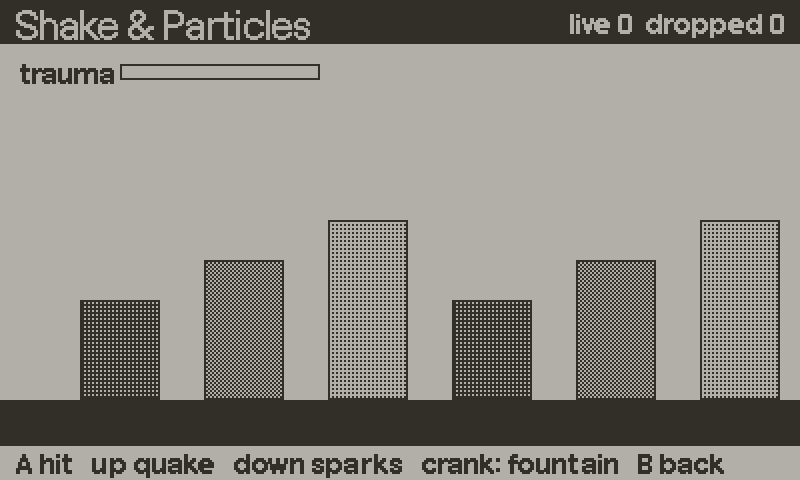

# particles



A pooled particle system for a 1-bit screen. The pool is allocated once in `Particles.new`, and `emit`, `update` and `draw` create no tables. There is no alpha on this screen, so particles fade by dithering, shrink, or stay solid. Three presets cover impacts, smoke and sparks, and you can pass your own spec.

## Setup

```lua
import "juice/particles"

Particles.load()                -- once at boot
local ps = Particles.new(200)   -- capacity: the most live particles at once
```

Without `Particles.load()`, `draw` does nothing. The simulation still runs.

## Minimal example

```lua
local ps = Particles.new(200)

function onExplosion(x, y)
    ps:emit(x, y, "burst")
end

function playdate.update()
    ps:update()
    drawWorld()
    ps:draw()
end
```

## Recipes

### Hit shake plus sparks

See [shake.md](shake.md).

```lua
local sh = Shake.new("hit")
local ps = Particles.new(200)

function onHit(x, y)
    sh:add(0.5)
    ps:emit(x, y, "spark", 12)
end
```

### Sparks off a surface

`spark` fires upward by default (270 degrees). Pass a direction to aim it. Angles are in degrees, 0 is right, and they grow clockwise.

```lua
ps:emit(wallX, hitY, "spark", 10, 180)   -- spray left
```

### Smoke

`puff` drifts up and dithers away. It is the preset that looks like smoke in 1 bit.

```lua
ps:emit(chimneyX, chimneyY, "puff")
```

### Your own spec

A spec is a table shaped like a preset. `speed`, `life` and `size` are `{ min, max }` ranges.

```lua
local confetti = {
    n = 30, speed = { 1, 4 }, life = { 20, 40 }, size = { 2, 3 },
    style = Particles.FADE, grav = 0.1, drag = 0.03,
    spread = 120, dir = 270,
}
ps:emit(x, y, confetti)
```

### Crank-driven fountain

```lua
function playdate.update()
    local angle = playdate.getCrankPosition() - 90   -- crank 0 is up, 0 degrees here is right
    ps:emit(200, 200, "spark", 1, angle)
    ps:update()
    ps:draw()
end
```

### Reproducible sprays and white particles

```lua
local a = Particles.new(100, { seed = 42 })
local b = Particles.new(100, { color = "white" })   -- use SOLID or SHRINK styles
```

## API reference

### Module

| Function | Description |
|---|---|
| `Particles.new(capacity, opts)` | Creates a system. `capacity` defaults to 128. |
| `Particles.load()` | Enables `draw` when the SDK is present. Returns true if it is. |
| `Particles.SOLID`, `Particles.FADE`, `Particles.SHRINK` | Style constants. |
| `Particles.PRESETS` | `burst`, `puff`, `spark`. |

`opts` for `Particles.new`:

| Option | Default | Description |
|---|---|---|
| `seed` | 1 | Any integer. The same seed gives the same spray. |
| `rand` | nil | A function returning a number in [0, 1). Replaces the built-in generator. |
| `color` | `"black"` | `"black"` or `"white"`. |

### Spec fields

| Field | Default | Description |
|---|---|---|
| `n` | 8 | Count. Overridden by the `n` argument of `emit`. |
| `speed` | `{1, 1}` | Pixels per frame, `{ min, max }`. |
| `life` | `{12, 12}` | Frames. |
| `size` | `{2, 2}` | Pixels, rounded to an integer of at least 1. |
| `style` | `SOLID` | `SOLID`: constant size and ink. `FADE`: dithers out over its life. `SHRINK`: solid, shrinks to one pixel. |
| `grav` | 0 | Added to vertical velocity each frame. Positive is down. |
| `drag` | 0 | Linear damping per frame. |
| `spread` | 360 | Cone width in degrees. |
| `dir` | 0 | Cone centre in degrees. Overridden by the `dir` argument of `emit`. |

| Preset | n | style | spread | Notes |
|---|---|---|---|---|
| `burst` | 14 | SOLID | 360 | Hard dots, no gravity. Reads as an impact. |
| `puff` | 10 | FADE | 360 | Slow and big, drifts up. |
| `spark` | 18 | SHRINK | 70 | Fast, falls, aimed up (`dir = 270`). |

### System methods

| Method | Description |
|---|---|
| `ps:emit(x, y, spec, n, dir)` | Fires particles. `spec` is a preset name or a table (default `burst`). Returns the number actually emitted. |
| `ps:update(dt)` | Advances one frame (`dt` default 1). Returns the live count. |
| `ps:draw()` | Draws all live particles in the current draw offset. |
| `ps:clear()` | Removes all particles. Returns `ps`. |
| `ps:free()` | Free slots. |
| `ps:isEmpty()` | True if nothing is alive. |
| `ps:each(fn)` | Calls `fn(particle, index)` for each live particle, for custom drawing. |
| `ps:setSeed(n)` | Resets the generator. |
| `ps:random()` | Next number in [0, 1). |

Fields: `capacity`, `count` (live), `dropped` (emits lost to a full pool), `pool`.

## Gotchas

- Call `Particles.load()` once, or nothing is drawn.
- Emits past capacity are dropped, not queued and not recycled. If `ps.dropped` grows, raise the capacity. `emit` returns how many were created.
- There is one pool per system. Several small systems are fine, but each allocates `capacity` tables at creation.
- A `"white"` system draws white ink. `FADE` uses a black dither pattern, so on white it flips to black halfway. Use `SOLID` or `SHRINK`.
- Particles move in screen coordinates. Draw them inside `Shake.apply` / `Shake.pop` if they should shake with the world.
- `draw` leaves the draw colour black.
- Velocities are pixels per frame and lifetimes are frames, not seconds.
