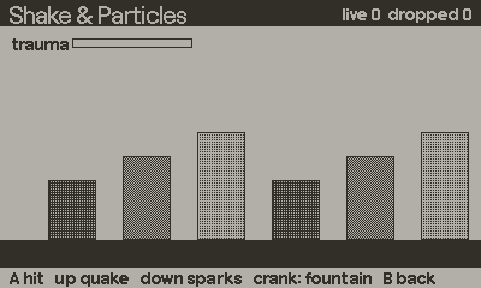

# shake



Trauma-based screen shake. A shaker holds one energy value from 0 to 1. Events add to it, it decays linearly each frame, and the offset is driven by trauma squared or cubed. That makes a shake hit hard and taper off smoothly. The noise is seeded, so a shake is reproducible.

Offsets are integers, since the screen is 1-bit. Shakers are instances, so a UI panel can rattle while the world stays still.

## Setup

```lua
import "juice/shake"

Shake.load()      -- once at boot
```

Without `Shake.load()`, `Shake.apply` and `Shake.pop` do nothing. The shaker math still works.

## Minimal example

```lua
local sh = Shake.new("hit")

function onHit()
    sh:add(0.6)
end

function playdate.update()
    sh:update()
    Shake.apply(sh)
    drawWorld()
    Shake.pop()
    drawHud()          -- not shaken
end
```

## Recipes

### Hit shake with particles

See [particles.md](particles.md) for the particle half.

```lua
local sh = Shake.new("hit")
local ps = Particles.new(200)

function onEnemyHit(x, y)
    sh:add(0.5)
    ps:emit(x, y, "spark", 12)
end

function playdate.update()
    sh:update()
    ps:update()
    Shake.apply(sh)
    drawWorld()
    ps:draw()          -- shakes with the world
    Shake.pop()
end
```

### One shared shaker

For a game with a single screen shake, skip passing it around.

```lua
Shake.main("quake")            -- created on first call with these options
Shake.main():add(1.0)
-- per frame
Shake.main():update()
Shake.apply(Shake.main())
```

The options are only used the first time `Shake.main` is called.

### Presets and custom shakers

```lua
local bump   = Shake.new("bump")     -- small and soft
local quake  = Shake.new("quake")    -- big and long
local custom = Shake.new{ amplitude = 4, decay = 0.08, frequency = 0.6, power = 2, seed = 7 }
```

### Rattle one UI element

Do not use `Shake.apply`. Read the offset and draw the element yourself.

```lua
local rattle = Shake.new("rattle")
-- on error
rattle:add(0.8)
-- per frame
rattle:update()
local dx, dy = rattle:offset()
panelImage:draw(x + dx, y + dy)
```

### Rotation

`apply` only moves the screen. A shaker also produces a roll angle in degrees, which you can feed to `image:drawRotated`.

```lua
sh:update()
local angle = sh:rotationAngle()
bossImage:drawRotated(x + sh.dx, y + sh.dy, angle)
```

Presets `hit` and `quake` have rotation. The others have 0.

### Set or cut the shake directly

```lua
sh:setTrauma(1)    -- set directly
sh:stop()          -- cut it dead and recentre
if sh:isActive() then ... end
```

## API reference

### Module

| Function | Description |
|---|---|
| `Shake.new(opts)` | Creates a shaker. `opts` is a preset name or a table (below). With no argument, it uses the `hit` preset. |
| `Shake.main(opts)` | A shared shaker, created on the first call with `opts`. |
| `Shake.load()` | Enables `apply` and `pop` when the SDK is present. Returns true if it is. |
| `Shake.apply(shaker)` | Adds the shaker's offset to the current draw offset (the previous one is saved). Returns `dx, dy`. |
| `Shake.pop()` | Restores the draw offset saved by the last `apply`. |
| `Shake.PRESETS` | `bump`, `hit`, `quake`, `rattle`. |
| `Shake.noise(channel, t)`, `Shake.hash32(n)`, `Shake.MASK` | The noise functions, exposed for tests. |

Options for `Shake.new`:

| Option | Default | Description |
|---|---|---|
| `amplitude` | 6 | Largest offset in pixels at trauma 1. Use a whole number. |
| `rotation` | 0 | Largest roll in degrees at trauma 1. |
| `decay` | 0.06 | Trauma removed per frame. |
| `frequency` | 0.45 | Noise steps per frame. Higher is twitchier. |
| `power` | 2 | Exponent on trauma. 2 is punchy, 3 is very tapered. |
| `seed` | 1 | Any integer. Different seeds shake differently. |

| Preset | amplitude | rotation | decay | frequency | power |
|---|---|---|---|---|---|
| `bump` | 3 | 0 | 0.10 | 0.55 | 2 |
| `hit` | 6 | 1.5 | 0.06 | 0.45 | 2 |
| `quake` | 10 | 3.0 | 0.02 | 0.22 | 3 |
| `rattle` | 2 | 0 | 0.04 | 0.90 | 2 |

### Shaker methods

| Method | Description |
|---|---|
| `s:add(amount)` | Adds trauma, clamped to 0..1. Default 0.5. Returns the new trauma. |
| `s:setTrauma(v)` | Sets trauma, clamped to 0..1. |
| `s:update(dt)` | Advances one frame (`dt` in frames, default 1). Returns `dx, dy`. |
| `s:offset()` | Returns `dx, dy`. |
| `s:rotationAngle()` | Roll in degrees, a float. |
| `s:isActive()` | True while trauma is above 0. |
| `s:stop()` | Trauma to 0, offsets to exactly 0. |

Fields: `trauma`, `dx`, `dy`, `roll`, `time`, plus the options above.

## Gotchas

- Call `Shake.load()` once. Without it `apply` does nothing and no error is shown.
- Pair every `apply` with a `pop`. The save stack is 8 deep, and `apply`/`pop` nest.
- `apply` uses `setDrawOffset`, which affects everything drawn afterwards, including sprites. Draw the HUD after `pop`.
- `update` must run every frame. Trauma only decays there.
- `Shake.new("name")` with a name that is not a preset falls back to the `hit` preset without an error.
- Rotation is never applied for you. `setDrawOffset` cannot rotate.
- `Shake.main(opts)` ignores `opts` after the first call.
- Keep `amplitude` a whole number, or the promised bound on the offset is not exact.
