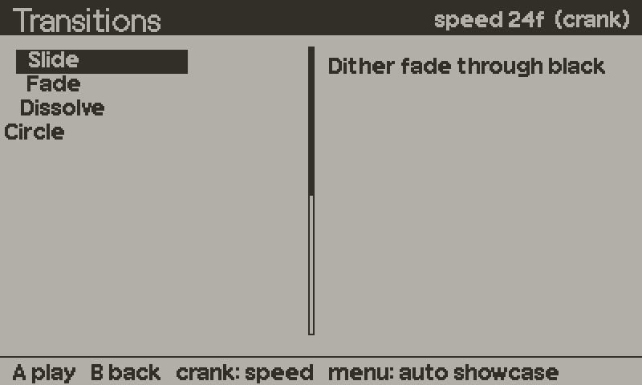

# transitions



23 scene transitions, each with a forward and a back direction. You start one when you swap scenes and wrap your per-frame scene code in `Transitions.draw`. The module snapshots the outgoing and incoming screens once, then composites the two images for the length of the wipe.

It also has a scene-hop plan: one table that says which hop between your scenes gets which effect, so call sites just name the hop.

Effects: Slide, Fade, Dissolve, Circle, Diamonds, Diamond Wave, Triangles, Bubbles, Blinds, Clock Wipe, Wave Wipe, Interleave, Dither Bands, Spiral, Wind, Melt, Shatter, Scanline, Pixel Shift, Hexagons, Diagonal, Paw Walk, Blink.

## Setup

```lua
import "juice/transitions"
```

Nothing is allocated at import. The two full-screen buffers are created on the first `Transitions.start`, or earlier if you call `Transitions.load()` at boot.

Paw Walk reads `images/paw_print.png` and `images/paw_plate.png` (shipped in the repo's `images/` folder) the first time it runs. If they are missing it runs as an unstamped wipe. If you put them elsewhere, call `Transitions.setImagePath("my/folder/")`.

## Minimal example

```lua
import "juice/transitions"

local scene = menuScene

function changeScene(next)
    Transitions.start("Slide", "fwd", 24)   -- effect, direction, frames
    scene = next
end

function playdate.update()
    if not Transitions.active then scene:input() end
    Transitions.draw(function()
        scene:update()
        scene:draw()
    end)
end
```

Call `start` while the screen still shows the outgoing scene. The snapshot of the outgoing side is the last frame that was put on the display. Then swap the scene. On the next `Transitions.draw`, the function runs once into an offscreen buffer to capture the incoming scene, and the wipe plays from the two images.

## Recipes

### Scene-hop plan

Declare what each hop means once, at boot. Hops you leave out of the plan do nothing, and the second table records why a hop is deliberately bare.

```lua
Transitions.setPlan({
    ["menu>rules"] = { "Paw Walk", "fwd",  16 },
    ["rules>menu"] = { "Paw Walk", "back", 16 },
    ["menu>run"]   = { "Blink",    "fwd",  20 },
}, {
    ["loading>game"] = "the board plays its own entry reveal",
})

-- at the call site
Transitions.play("menu>rules")
currentScene = rulesScene
```

`setPlan` raises an error for an unknown effect, a key without `>`, a bad frame count, or a hop listed in both tables. `Transitions.play` is a no-op for unknown or bare hops, and while another transition is running.

### Keep the new scene running during the wipe

With one function, the draw is captured on the first frame and then frozen. If you pass an update function and a draw function separately, the update runs every frame of the wipe (timers, tweens and input keep working) and only the draw is frozen.

```lua
function playdate.update()
    Transitions.draw(
        function() scene:update() end,   -- every frame, wipe or not
        function() scene:draw() end)     -- captured once per wipe
end
```

### Back navigation

`"back"` runs the effect mirrored. Anything that is not exactly `"back"` is treated as `"fwd"`.

```lua
function goBack()
    Transitions.start("Circle", "back", 20)
    scene = previousScene
end
```

### Sounds for transitions

If a global `TransitionSounds` exists when a transition starts, `TransitionSounds.play(name, dir)` is called. The shipped SFX bank has a whoosh for every effect and direction:

```lua
TransitionSounds = {
    play = function(name, dir)
        return Chiptune.sfx("tr_" .. name:lower():gsub(" ", "_") .. "_" .. dir)
    end,
}
```

`name` is the canonical effect name, such as `"Paw Walk"`, and `dir` is `"fwd"` or `"back"`.

### Pick an effect at random

```lua
local name = Transitions.names[math.random(#Transitions.names)]
Transitions.start(name, "fwd", 24)
```

## API reference

### Functions

| Function | Description |
|---|---|
| `Transitions.start(effect, direction, duration)` | Starts a transition. `effect` is a name (see `canonical`). `direction` is `"fwd"` or `"back"`, default forward. `duration` in frames, default 24. Unknown effect: silent no-op. Does nothing without the SDK. Calls `TransitionSounds.play` if that global exists. |
| `Transitions.draw(fn)` | Per-frame wrapper, one-function form. Runs `fn` normally when idle. During a transition, runs it once into the capture buffer, then only composites. |
| `Transitions.draw(updateFn, drawFn)` | Split form. `updateFn` runs every frame. `drawFn` runs normally when idle and once into the capture buffer during a wipe. |
| `Transitions.wrap` | Alias of `Transitions.draw`. |
| `Transitions.play(hop)` | Starts the transition the plan gives `hop` (`"from>to"`). No-op for bare or unknown hops, and while a transition is active. |
| `Transitions.setPlan(plan, bare)` | Registers the plan: `{ ["from>to"] = { effect, dir, frames } }`. Frames default to 24 and `dir` is normalised. `bare` is `{ ["from>to"] = "reason" }`. Both default to `{}`. Returns the resolved plan. Raises on invalid input. |
| `Transitions.forHop(hop)` | Returns `effect, dir, frames` for a planned hop, or `nil`. Also available as `Transitions.for_hop`. |
| `Transitions.bareReason(hop)` | The reason string registered for a bare hop. |
| `Transitions.load(opts)` | Allocates the buffers now. Idempotent. `opts.imagePath` is passed to `setImagePath`. |
| `Transitions.setImagePath(prefix)` | Folder for the paw images, default `"images/"`. A trailing `/` is added if missing. Returns the path. |
| `Transitions.canonical(name)` | Resolves a name to the canonical effect name, or `nil`. Case and spaces are ignored, so `"pawwalk"` and `"Paw Walk"` match. `"paw"` is an alias for Paw Walk. |
| `Transitions.hasEffect(name)` | True if the name resolves to an implemented effect. |
| `Transitions.normalizeDir(dir)` | `"back"` stays `"back"`, everything else becomes `"fwd"`. |
| `Transitions.progress(frame, frames)` | Frame to 0..1. The last frame (`frames - 1`) is exactly 1. `frames` defaults to 24. |
| `Transitions.setFrames(n)` / `Transitions.getFrames()` | Overwrite or read the duration of the current transition. `getFrames` returns 24 before any transition. |

### Fields

| Field | Description |
|---|---|
| `Transitions.active` | True while a transition is running. Gate input on it. |
| `Transitions.capturing` | True while the scene is being drawn into the capture buffer. |
| `Transitions.names` | The 23 effect names, in order. |
| `Transitions.descriptions` | Name to one-line description. |
| `Transitions.PLAN`, `Transitions.BARE` | The tables set by `setPlan`. |
| `Transitions.FREEZES_INCOMING` | Always true. The incoming draw is captured once. |
| `Transitions.SPLITS_UPDATE_FROM_DRAW` | Always true. Marks that the two-function `draw` exists. |

## Gotchas

- Call `start` before you swap scenes and before you draw the new one. The outgoing snapshot is the last frame shown on the display.
- In the one-function form the scene is frozen after the first wipe frame: its update does not run until the wipe ends. Use the two-function form if the incoming scene has timers or tweens that must keep going.
- Gate input yourself with `Transitions.active`. The module does not block it.
- The capture buffer is reused and not cleared between transitions, so your draw function should paint the whole screen.
- Starting a transition while one is active replaces it. `Transitions.play` refuses instead.
- Without the SDK, `start` does nothing and `draw` just calls your function, so the module is safe under host Lua.
- Effects are fixed at 400 by 240.
