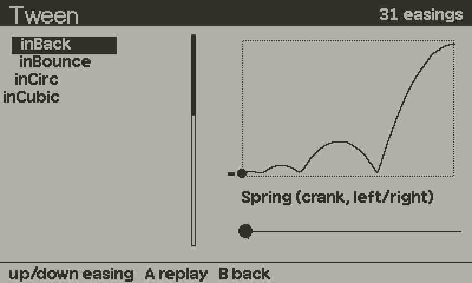

# tween



Tweens, sequences, parallel groups and springs, stepped by frame count. 31 easings in the normalised `f(t) -> t` form. `Tween.update` allocates nothing in steady state, because finished tweens go back into a pool.

The SDK has `playdate.easingFunctions` and `playdate.timer`. Use this module when you want animation logic that runs under host Lua, steps by frames rather than wall-clock time, nests sequences and groups, or needs a spring. The SDK's four-argument easings can be wrapped with `Tween.penner(name)`.

## Setup

```lua
import "juice/tween"

function playdate.update()
    Tween.update()      -- once per frame
end
```

No `load` call. It is pure Lua and works the same on host and device.

## Minimal example

```lua
local box = { x = 0, y = 100 }

Tween.to(box, 30, { x = 200, y = 120 }, "outBack")
    :onComplete(function() print("arrived") end)
```

`Tween.to(obj, frames, fields, ease)` writes `box.x` and `box.y` each frame. The start values are read from the object when the tween first runs. The final frame writes the target exactly. `ease` is a name from `Tween.easeNames`, a function, or nil for linear.

## Recipes

### Menu opens

A sequence runs its members one after another. A parallel group runs them together.

```lua
local menu = { y = 240, itemX = -80, dim = 0 }

Tween.sequence(
    Tween.field(menu, 12, "y", 60, "outCubic"),
    Tween.parallel(
        Tween.field(menu, 10, "itemX", 24, "outBack"),
        Tween.field(menu, 10, "dim", 1)
    ),
    Tween.call(function() menu.ready = true end)
)
```

Members are adopted by the group. Do not keep a reference and update them yourself.

### Move a sprite

Tween a plain table and move the sprite from `onUpdate`.

```lua
local pos = { x = sprite.x, y = sprite.y }
Tween.to(pos, 20, { x = 300, y = 80 }, "inOutCubic")
    :snap()
    :onUpdate(function() sprite:moveTo(pos.x, pos.y) end)
```

`snap()` rounds each written value to an integer, which matches what the 1-bit screen shows.

### Tween a bare number

```lua
local fade = Tween.value(0, 1, 15, "outQuad")
-- each frame
local alpha = fade.value
```

### Pause between steps

```lua
Tween.sequence(
    Tween.field(title, 20, "y", 40, "outBounce"),
    Tween.delay(30),
    Tween.field(title, 15, "y", -40, "inBack")
)
```

### A camera that follows a moving target

An easing needs a fixed destination. A spring does not.

```lua
local camX = Tween.newSpring(0, 8)     -- initial value, smooth time in frames

function playdate.update()
    local x = camX:update(player.x - 200)
    gfx.setDrawOffset(-x, 0)
end
```

A spring never overshoots and converges asymptotically, so it never lands exactly on the target. If you need an exact resting value, use a tween.

### Hold a handle past completion

A finished tween's table is reused by the next tween. If you keep a handle, call `keep()` first.

```lua
local intro = Tween.to(logo, 40, { y = 60 }, "outBack"):keep()
-- later, safely
intro:restart()
```

### Cancel everything on a scene change

```lua
Tween.stopAll()    -- cancels, leaves values where they are, runs no callbacks
-- or, from a hard reset:
Tween.reset()      -- drops all tweens and empties the pool
```

## API reference

### Creating tweens

All of these return a handle and start immediately. They take effect on the next `Tween.update`.

| Function | Description |
|---|---|
| `Tween.to(obj, frames, fields, ease)` | Tweens several numeric fields of `obj`. `fields` is `{ key = target }`. |
| `Tween.field(obj, frames, key, toValue, ease)` | One field, without the table literal. |
| `Tween.value(from, to, frames, ease)` | A bare number. Read it from `handle.value`. |
| `Tween.delay(frames)` | Does nothing for `frames`. For sequences. |
| `Tween.call(fn)` | A zero-length step that calls `fn(handle)` when reached. For sequences. |
| `Tween.sequence(...)` | Runs the given tweens in order. Leftover time carries over, so three 10-frame tweens end on update 30. |
| `Tween.parallel(...)` | Runs them together. Ends when the last one ends. |
| `Tween.chain` | Alias of `Tween.sequence`. |

`ease` for every constructor above: a name in `Tween.ease`, a function `f(t) -> t`, or nil for linear. An unknown name raises an error. A non-numeric field raises an error on the first update.

### Handle methods

All return the handle, so they chain.

| Method | Description |
|---|---|
| `:onComplete(fn)` | `fn(handle)` runs once when the tween finishes. |
| `:onUpdate(fn)` | `fn(handle)` runs after every step. |
| `:snap(on)` | Round written values to integers. `on` defaults to true. |
| `:keep()` | Do not recycle the handle after completion. |
| `:pause()` / `:resume()` | |
| `:cancel()` | Stops where it stands. No final value, no callback. |
| `:finish()` | Jumps to the end: writes the targets and fires the callback. |
| `:restart()` | Plays again from the recorded start values. On a recycled handle it raises an error, so call `keep()` first. |

Handle fields: `done`, `cancelled`, `paused`, `progress` (0..1, linear), `eased` (0..1, after easing), `frame`, `frames`, `value` (for `Tween.value`).

### Driver

| Function | Description |
|---|---|
| `Tween.update(dt)` | Advances every tween by `dt` frames, default 1. A tween created during an update (for example in a callback) starts on the next update. |
| `Tween.count()` | Number of active top-level tweens. |
| `Tween.poolSize()` | Number of recycled tweens waiting for reuse. |
| `Tween.stopAll()` | Cancels all active tweens. |
| `Tween.reset()` | Drops everything without callbacks and empties the pool. |
| `Tween.release(node)` | Returns a node to the pool. Normally not needed. |

### Easings

`Tween.ease[name](t)` takes t in 0..1 and returns the eased value. It returns exactly 0 for `t <= 0` and exactly 1 for `t >= 1`.

`Tween.easeNames` is the sorted list of the 31 names: `linear`, and `in`, `out` and `inOut` variants of `Quad`, `Cubic`, `Quart`, `Quint`, `Sine`, `Expo`, `Circ`, `Back`, `Elastic`, `Bounce`. For example `outBack`, `inOutCubic`, `outBounce`.

| Function | Description |
|---|---|
| `Tween.fromPenner(f)` | Wraps a Penner `f(t, b, c, d)` function into the normalised form. Allocates a closure, so call it at setup. |
| `Tween.penner(name)` | The same, looked up by name in `playdate.easingFunctions`. Returns nil under host Lua or for an unknown name. |

### Helpers

| Function | Description |
|---|---|
| `Tween.lerp(a, b, t)` | `(1 - t) * a + t * b`. Exact at both ends. |
| `Tween.damp(current, target, halfLife, dt)` | Exponential smoothing with a half-life in frames. `dt` defaults to 1. A half-life of 0 or less returns `target`. The result does not depend on the step size. |

### Springs

`Tween.newSpring(value, smoothTime, maxSpeed)` returns a critically damped spring. Defaults: value `0`, `smoothTime` `10` frames, `maxSpeed` unlimited.

| Member | Description |
|---|---|
| `spring:update(target, dt)` | Moves towards `target` and returns the new value. `dt` defaults to 1. |
| `spring:reset(value)` | Sets the value (default 0) and zeroes the velocity. |
| `spring.value`, `spring.velocity`, `spring.smoothTime`, `spring.maxSpeed` | Readable and writable. |

## Gotchas

- Call `Tween.update()` once per frame, or nothing moves.
- Stale handles: after completion or cancel, a handle's table may belong to a new tween. Call `keep()` if you hold it past completion, and check `done` before cancelling a handle you saved.
- Children of `sequence` and `parallel` are owned by the group. Do not update, cancel or restart them separately.
- `from` values are read when a tween first runs, not when it is created, so a second step in a sequence starts where the first left the object.
- `cancel` leaves values where they are. `finish` jumps to the end and fires `onComplete`.
- `Tween.stopAll` and `cancel` skip callbacks. A callback is allowed to call `Tween.reset()`.
- Time is in frames. If you run at a different refresh rate, pass `dt = 30 / refreshRate` to `Tween.update`.
