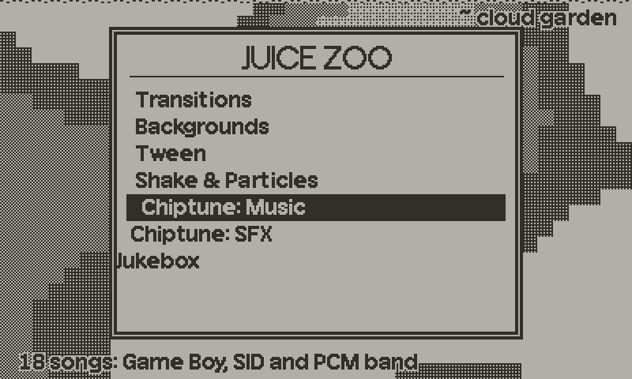

# ui.lua



Menu plumbing for Playdate games, global `UI`. It covers the parts a menu
needs and nothing more: d-pad key repeat, a scrolling list with a springy
highlight, a scrolling grid, panels, header and footer bars, a scroll bar,
level meters and outlined text. It was extracted from the Juice Zoo demo.

It imports no other module. The highlight spring is a small copy of the
critically damped one in `tween.lua`. Under host `lua` the input and scroll
maths work and the draw functions do nothing.

## Example

```lua
import "ui"

UI.font.title, UI.font.body = titleFont, bodyFont

local rep  = UI.repeater()
local menu = UI.list{ items = { "Play", "Options", "Quit" },
                      x = 120, y = 90, w = 160, rowH = 18, visible = 3 }

function playdate.update()
    rep:poll()                       -- read the d-pad once per frame
    menu:navigate(rep)               -- up/down, wraps, repeats when held
    if playdate.buttonJustPressed(playdate.kButtonA) then
        print("chose", menu.items[menu.sel])
    end

    gfx.clear(gfx.kColorWhite)
    UI.header("My Game", "v1.0")
    menu:draw()
    UI.footer("A select")
end
```

## Key repeat

`UI.repeater(delay, every)` returns a repeater. A key steps on the frame it
goes down; if it stays down for more than `delay` frames (default 10) it steps
again every `every` frames (default 3).

| Call | |
|---|---|
| `rep:poll()` | Reads up, down, left, right from the SDK. Does nothing under host `lua`. |
| `rep:feed(key, down)` | Records whether `key` (any name) is down this frame. `poll` uses this; call it yourself for other buttons or in tests. |
| `rep:step(key)` | True on the press frame and on each repeat. Keys from `poll` are `"up"`, `"down"`, `"left"`, `"right"`. |
| `rep:axis(neg, pos)` | -1, 0 or 1 from two keys. The first wins if both step. |
| `rep:vertical()`, `rep:horizontal()` | `axis("up","down")` and `axis("left","right")`. |

## Lists

`UI.list(opts)` is a vertical list with a highlight bar that follows the
selection through a spring. It scrolls when there are more items than rows.

Options: `items` (array; strings, or anything if you give `label`), `x`, `y`,
`w`, `rowH`, `visible` (rows shown), `label(item, i)` (returns the text),
`smooth` (spring time in frames, default 3), `sel` (default 1), `scrollbar`
(draw a bar to the right when items overflow, default false), plus the effect
settings under Effects.

| Call | |
|---|---|
| `list.sel` | Selected index. Assign to it to jump. |
| `list:move(d)` | Move by `d`, wrapping at both ends (a wrap bumps the list). True if it moved. |
| `list:select(i)` | Jump to item `i` with the fill and nudge effects, no bump. |
| `list:confirm()` | Blink the selected row inverted and kick it. |
| `list:enter(delay)` | Start the staggered entrance, first row after `delay` frames. |
| `list:update()` | Advance the animations one frame. `draw` does this. |
| `list:navigate(rep)` | `move(rep:vertical())`. |
| `list:first()` | Index of the first visible row. |
| `list:setItems(items)` | Replace the items and clamp `sel`. |
| `list:draw()` | Draws the bar and rows, returns the first visible index. |

## Grids

`UI.grid(opts)` is a row-major grid of text cells that scrolls by rows.
Options: `cols` (default 3), `visible` (rows shown, default 8), `items`
(strings to draw), `smooth`, plus the effect settings under Effects.

| Call | |
|---|---|
| `grid.sel`, `grid.top` | Selected index (1-based) and first visible row (0-based). |
| `grid:move(dx, dy)` | Step by cells. Left/right wrap inside the row, up/down wrap through the rows. A short last row clamps to its last cell. |
| `grid:navigate(rep)` | `move(rep:horizontal(), rep:vertical())`. |
| `grid:scroll(rows)` | Move whole rows without wrapping, for the crank (`playdate.getCrankTicks`). At the first or last row it bumps the grid and returns false. |
| `grid:confirm()`, `grid:enter(delay)`, `grid:update()` | As for lists. The entrance staggers by row. |
| `grid:setItems(items)` | Replace the items and clamp `sel`. |
| `grid:rows()` | Number of rows. |
| `grid:draw(x, y, colW, rowH)` | Draws the visible rows clipped, gliding to the scroll position, plus a scroll bar to the right when there are more rows than fit. |

## Drawing helpers

| Call | |
|---|---|
| `UI.font` | Table with `title` and `body` fonts used by the helpers. Unset fonts leave the current font alone. |
| `UI.panel(x, y, w, h, scale)` | White box with a double black border. `scale` is optional and draws it grown or shrunk around its centre. |
| `UI.header(text, sub)` | 22 px black bar across the top; `sub` is optional and right-aligned. |
| `UI.footer(text)` | 18 px bar across the bottom with a rule above it. |
| `UI.outlined(text, x, y)` | Black text with a white outline, for use over a busy background. Nine `drawText` calls. |
| `UI.scrollbar(x, y, w, h, top, visible, total)` | Outlined track with a thumb. |
| `UI.meters(opts)` | Level meters object, see below. |

The bars assume the 400x240 screen.

## Meters

`UI.meters{ top, decay, labels }` keeps a falling peak tick per bar. `top` is
the full-scale level (default 15), `decay` is how far the peak falls each frame
(default 0.5), `labels` are names drawn under the bars when their count equals
the number of bars and each bar is at least 30 px wide; otherwise bars are
numbered.

`meters:draw(levels, n, x, y, h, width, cursor, muted)` draws `n` bars from the
`levels` array into `width` pixels. `cursor` is a bar index to underline and
`muted[c]` crosses a bar out. Pass the same `levels` table every frame.

## Helpers

| Call | |
|---|---|
| `UI.wrap(i, d, n)` | Step `i` by `d` within 1..n, wrapping. |
| `UI.window(sel, n, visible)` | First visible index for a list of `n` items, keeping `sel` near the middle and the window inside the list. |
| `UI.thumb(h, top, visible, total)` | Scroll bar thumb offset and size in a track `h` px tall. |
| `UI.plain(name)` | Replaces `_` with spaces so names from data are not drawn as italics. Cached. |
| `UI.spring(value, smoothTime)` | The highlight spring: `update(target)` returns the new value, `reset(value)` resets. |
| `UI.wobble(k, damp)` | Damped oscillator for offsets that overshoot: `kick(v)`, `update()`, field `pos`. Lands exactly on 0. |
| `UI.stagger(t, i, delay, dur)` | Progress 0..1 of item `i` (0-based) in a staggered entrance `t` frames in. |
| `UI.popScale(t, dur)` | Scale for a pop-open: 0, overshoots about 10%, then 1. |
| `UI.easeOut(p)` | Cubic ease-out. |
| `UI.cellBar(x, w, need, right)` | Highlight rect for a grid cell whose text may be wider than the cell: returns x and width, widened to `need` and slid left to stay before `right`. `grid:draw` uses it so the selected text is always whole. |

## Effects

Lists and grids animate by default. Pass any of these to `UI.list` or
`UI.grid`; `0` turns that effect off.

| Option | Default | Effect |
|---|---|---|
| `fill` | 6 | Frames for the highlight to grow in from the left (starting at 30% width) when the selection changes. It slides vertically through the spring as before. |
| `nudge` | 4 | Pixels the selected row is pushed right. It starts behind, overshoots and settles; the row you left eases back. |
| `bump` | 4 | Kick to the whole list when the selection wraps top to bottom, or the grid hits the end of `scroll`. |
| `flash` | 8 | Frames the row blinks inverted after `confirm()`. |
| `stagger` | 2 | Frames between rows starting their entrance after `enter()`. |
| `slide` | 24 | Pixels each row slides in from the left. |
| `enterDur` | 6 | Frames each row takes to slide in. |

The entrance does not play unless you call `enter()`. Its clock runs while
the list is drawn, so a delay of a few frames lets a screen transition finish
first. Assigning `list.sel` directly skips the effects.

A panel pops open by passing `UI.popScale(frames, dur)` as the `scale` of
`UI.panel`; draw the contents once it returns 1. The list scroll bar
(`scrollbar = true`) and the grid's follow their window through a spring.

The selection always stays visible: the highlight bar of a list never leaves
the rows, and the grid clamps its scroll spring each frame so the selected
row is inside the window even while the other rows are still gliding. Each
grid cell's text is clipped to its column; only the selected cell widens.

All of it is plain frame counting, so a test can call `update()` and read
`fillT`, `flashT`, `enterT` and the `nudgeW` and `bumpW` wobbles.

## Notes

- Nothing allocates per frame once the objects exist. A `label` function that
  concatenates strings does, so build the labels once and pass them as
  `items`. `UI.plain` and the numeric meter labels are cached for the same
  reason.
- The list and grid advance their animations inside `draw`. A screen you do
  not draw does not animate, and you should not call `update()` as well.
- `grid:draw` clips to the grid area and puts its scroll bar at
  `x + cols * colW`.
- There is no focus or menu-stack object. The demo switches between panes
  with a plain variable, which a game does just as well.
